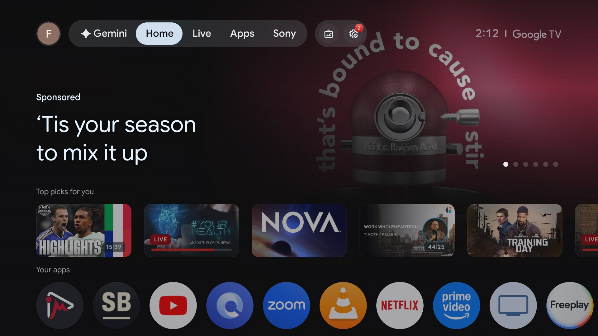
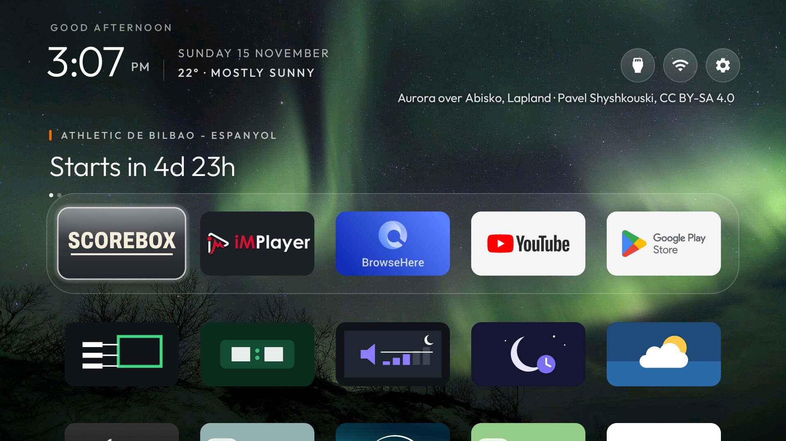

# Sony BRAVIA 7 (K-65XR70C), Google TV 14: soccer, weather by the clock, no ads

A living-room BRAVIA 7 cleaned with [CleanYourTV](https://github.com/Gathin23/cleanyourtv), plus two things this
fork adds: a weather line next to the clock and Game Day following the big soccer competitions.

| Before | After |
|---|---|
|  |  |

Android reports this set as `BRAVIA 4K AE2` (`BRAVIA_AE2_NA`), the same firmware as
[`sony-bravia-ae2`](../sony-bravia-ae2/), so its list was the starting point.

## What is here

| File | What it is |
|---|---|
| [`debloat.txt`](debloat.txt) | The list: 36 packages, disabled in six batches with a screenshot after each, then one reboot to check they held |
| [`config.json`](config.json) | The launcher setup: a five-app dock, the remote's app buttons, Game Day, the weather line and the Sweden look |
| [`calendars.conf`](calendars.conf) | Game Day's soccer calendars: Premier League, La Liga and Champions League |
| [`PROMPT-opus-5.5.md`](PROMPT-opus-5.5.md) | The prompt the cleanup was run with, written for Claude Opus 5.5 |

## Steps

Network ADB on this set is Wireless debugging only (port 5555 stays closed). Turn on Developer options and
Wireless debugging, pair once with `adb pair <tv ip>:<pairing port> <code>`, connect, and point the tools at that
connection ([`tools/native-adb.md`](../../tools/native-adb.md)):

```bash
export TV_ADB_BINARY=$(command -v adb) TV_HOST=<tv ip>:<connection port>
tools/disable.sh examples/sony-bravia-7-k65xr70c/debloat.txt
tools/docker-build.sh && SKIP_BUILD=1 HOME_KEY_SERVICE=1 launcher/build-and-install.sh
cp -R themes/sweden/wallpapers examples/sony-bravia-7-k65xr70c/
tools/theme.sh examples/sony-bravia-7-k65xr70c
```

Undo with `tools/restore.sh examples/sony-bravia-7-k65xr70c/debloat.txt com.google.android.apps.tv.launcherx`.

- **setupwraith owned the saved Wi-Fi.** `dumpsys wifi | grep -o 'cname=[^ ]*'` named it, so the network was
  forgotten and joined again in Settings before its line ran. The TV took a new IP address after the re-join.
- **Two tuner inputs stay.** `tools/disable.sh` held back `com.mediatek.dtv.tvinput.atsctuner` and
  `com.sony.dtv.tvinput.atsc3tuner` because they ask for `TV_INPUT_HARDWARE`; they are commented out in the list.
- **Remote buttons.** With `launcherx` off, the Settings and app buttons do nothing. `HOME_KEY_SERVICE=1` with
  this folder's `app_keys` brings back Netflix (583), YouTube (485) and Prime Video (490). The Settings button
  (646) needs `<item>646</item>` in `settings_key_scancodes` in `launcher/app/src/main/res/values/config.xml`, which
  a theme cannot set. The cost: a held Volume key moves one step per press.
- **Quiet Hours and a Bluetooth soundbar.** Quiet Hours counts any Bluetooth audio as headphones, so set
  Headphones to "Capped too" to cap a Bluetooth soundbar.

## Add-ons used

Weather, Game Day, Sources, Sleep Timer and Quiet Hours from [`addons/`](../../addons/), each built with
`tools/docker-build.sh addons/<name>`. Game Day's calendars:
`addons/game-day/setup.sh examples/sony-bravia-7-k65xr70c/calendars.conf`.

## Credit

The launcher, tools, add-ons and the AE2 list this builds on are [CleanYourTV](https://github.com/Gathin23/cleanyourtv)
by Gathin23 and its contributors, under the MIT licence. Sweden's wallpapers keep their own licences
([`themes/sweden/CREDITS.md`](../../themes/sweden/CREDITS.md)).
